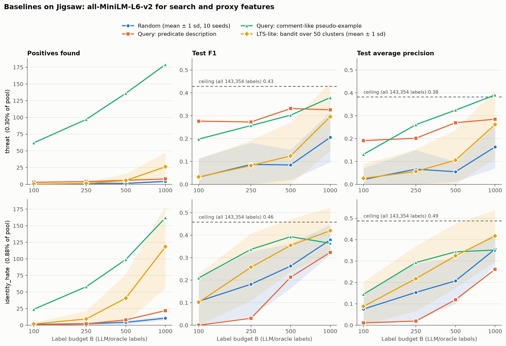

# EmbedSeek: Proxy Models for Needle-in-a-Haystack Semantic Filters

**Can a sampler that learns *which embedding space to search* find rare positives for an LLM-labeled proxy classifier better than any single embedding?**

NYU Data Engineering research project · Oct 11 – Dec 10, 2026
Team **EmbedSeek**: Thiago Viegas, Deep Paghdal, Prashanth Sreenivasan

---

## Contents
1. [The problem](#1-the-problem)
2. [Research questions](#2-research-questions)
3. [Approach](#3-approach)
4. [Samplers](#4-samplers)
5. [Datasets](#5-datasets)
6. [Evaluation protocol](#6-evaluation-protocol)
7. [Current status and results](#7-current-status-and-results)
8. [Quickstart](#8-quickstart)
9. [Repository layout](#9-repository-layout)
10. [Extending: adding a sampler](#10-extending-adding-a-sampler)
11. [Testing and reproducibility](#11-testing-and-reproducibility)
12. [Scope](#12-scope)
13. [Documentation map](#13-documentation-map)
14. [References](#14-references)

---

## 1. The problem

Databases now support **semantic filters**, SQL predicates evaluated by an LLM:

```sql
SELECT comment FROM comments WHERE AI.IF('contains a credible threat', comment);
```

Calling an LLM on every row is slow and expensive. The standard fix ([Chung et al., SIGMOD '26](docs/papers/01_chung2026_proxy_models.md)) is a **proxy model**: have the LLM label a small sample, train a cheap classifier (logistic regression on text embeddings) on those labels, and run the classifier over the full table. This gives >100x cost and latency savings at near-LLM accuracy.

**This breaks when the predicate is rare.** The sample is drawn at random, so rare positives barely show up in it:

| Prevalence | Positives in 500 random labels |
|---|---|
| 1% | ~5 |
| 0.3% (Jigsaw `threat`) | ~1.5 |
| 0.1% | ~0.5 |

A classifier can't learn "threat" from one example, and reweighting can't recover positives that were never sampled. Chung et al. call this "needle in a haystack" sampling problem open (§6.2).

**Our angle:** sample smartly using **embeddings**: search near the predicate, near positives already found, and across diverse regions. The new variable we study is **the embedding itself**. Different pretrained encoders arrange the same texts differently, so each may surface *different* positives. We test whether a lightweight **multi-armed bandit** can learn, from a few LLM labels, which embedding space is most productive for a given predicate.

## 2. Research questions

| | Question |
|---|---|
| **RQ1 Representation** | How much do rare-positive neighborhoods, query rankings and local purity differ across pretrained embeddings for the same predicate? |
| **RQ2 Discovery** | Do query-similarity, positive-anchor and diversity-aware sampling find more positives, and more *distinct kinds* of positives, per label than random selection? |
| **RQ3 Adaptation** | Does a feedback-driven policy that chooses among embedding spaces beat the **best fixed single-embedding strategy** at the same label budget? |
| **RQ4 Value and cost** | Do better samples give higher held-out proxy F1, and at what extra compute cost? |

**Hypothesis:** different embeddings capture complementary neighborhoods, and an adaptive policy can exploit that to find more diverse positives under a fixed labeling budget. This is a testable hypothesis, not an assumed outcome. It fails if all embeddings return the same neighbors, if feedback is too sparse, or if multi-encoder costs dominate. **A carefully characterized negative result is an acceptable outcome.**

## 3. Approach

The pipeline has two stages. **We vary only stage 1.** Stage 2 is identical for every method, so any difference in classifier quality comes from *which* records were labeled.

```
┌──────────── STAGE 1: ACQUISITION (the research variable) ────────────┐
│  unlabeled pool ──► SAMPLER picks B records ──► ORACLE labels them    │
│                     (random / query / anchor /   (human labels now,   │
│                      diversity / LTS-lite /       a real LLM later)   │
│                      BANDIT over embeddings)                          │
└──────────────────────────────┬───────────────────────────────────────┘
                               │ labeled set (B records)
┌──────────── STAGE 2: PROXY (fixed for every method) ─────────────────┐
│  logistic regression, class_weight="balanced", on ONE reference       │
│  embedding → threshold = best F1 on validation → score held-out test  │
└──────────────────────────────────────────────────────────────────────┘
```

**Embeddings play two roles:**

| Role | Embedding | Varies? |
|---|---|---|
| **Search space**: where a sampler looks for candidates | MiniLM, mpnet, bge, … The bandit switches among them | **Yes** (the research variable) |
| **Proxy features**: what the classifier is trained on | One fixed reference embedding | **No**, fixed so F1 differences reflect sampling, not classifier capacity |

**The proposed method:** each embedding space is an **arm** of a bandit. Each round:
1. Pick an embedding (Thompson sampling / UCB).
2. Propose a batch inside it (query similarity and/or neighbors of positives already found).
3. Get labels.
4. Reward the arm: r = (new positives + λ · new positive *types*) / labels used.

No record is labeled twice. Encoders are never fine-tuned.

## 4. Samplers

| Sampler | Idea | Learns from feedback? | Status |
|---|---|---|---|
| **Random** | Uniform sample: the current practice | No | ✅ implemented |
| **Query-seeded** | Top-B records by cosine similarity to an embedded predicate phrasing | No (one shot) | ✅ implemented |
| **LTS-lite** (competing baseline) | Simplified [Barbosa et al.](docs/papers/02_barbosa2025_lts_wildlife.md): Thompson sampling over k-means **clusters** of one embedding | Yes | ✅ implemented |
| **Positive-anchor** | Neighbors of positives already found ([SEALS](docs/papers/03_coleman2022_seals.md) / [AnchorAL](docs/papers/04_lesci2024_anchoral.md)), with diverse anchors and an exploration fraction | Yes | 🔜 next |
| **Diversity-aware** | Spread picks across regions among likely positives | Partly | 🔜 planned |
| **Fusion baselines** | Query/anchor search over concatenated or rank-fused embeddings | Partly | 🔜 planned |
| **EmbedSeek bandit** (ours) | Thompson sampling over **embedding spaces** | Yes | 🔜 planned (Week 5 go/no-go) |

The key comparison is **not** bandit vs random, which is easy to win. It's **the bandit vs the best fixed single-embedding sampler, LTS-lite (bandit over clusters) and fusion**. That separates "having a bandit" from "bandit arms = embedding spaces".

## 5. Datasets

| Dataset | Role | Predicates | Status |
|---|---|---|---|
| **Jigsaw Toxic Comments** (Wikipedia talk pages, 160K train / 64K scored test) | Naturally rare classes with human labels | `threat` (0.30%), `identity_hate` (0.88%) | ✅ downloaded, split, embedded |
| **MTEB classification** | Controlled pools at 20 / 5 / 1 / 0.5 / 0.1% prevalence | TBD | 🔜 |
| **BEIR** (SciFact or FiQA) | Query–document relevance with extremely sparse positives | Query = predicate | 🔜 |

**Jigsaw splits** (frozen, `scripts/make_splits.py`, seed 42):

| Split | Rows | threat | identity_hate | Use |
|---|---|---|---|---|
| pool | 143,354 | 427 | 1,257 | Samplers draw from here |
| val | 15,929 | 47 | 140 | Threshold selection only |
| test | 63,939 | 211 | 712 | Final metrics only; never seen during development |

Exact-text duplicates are removed (258), and pool/val rows whose text appears in test are dropped (30).

## 6. Evaluation protocol

**Acquisition metrics:** positives found per 100 labels; cumulative positives vs budget; distinct positive *subtypes* covered, measured **independently of the sampler's own embedding** (co-label combinations now, a small hand-annotated taxonomy planned). For bandits: arm allocation over rounds.

**Downstream metrics:** F1, precision, recall and average precision of the proxy on the held-out, human-labeled test set, at **natural prevalence**.

**Budgets:** B ∈ {100, 250, 500, 1000}. **Seeds:** 10 for every stochastic sampler.

**Cost:** per-encoder embedding time, index build, sampling overhead, labels × LLM cost, training and inference, with cold-start (embed everything) and cached scenarios reported separately:

C_adaptive = Σₘ C_embed,m + C_index + C_sample + B · c_LLM + C_train + C_infer

**Safeguards:**
- Splits are fixed **before** any prevalence manipulation. Pool, val and test are disjoint by ID and by text.
- Samplers see a label only after requesting it (enforced by tests).
- The threshold is chosen on validation and is provably independent of test labels (enforced by tests).
- **Labels:** simulated first, using human labels as a hidden oracle. Later a bounded run with a real LLM measures label noise.
- PCA/UMAP plots are exploratory only. Separation in 2D is never treated as evidence of classifier separability.

## 7. Current status and results

**Done (Week 2):** harness, frozen splits, MiniLM embeddings (4.3 min for 223K comments on Apple MPS), and the random, query-seeded, LTS-lite and full-label ceiling baselines on Jigsaw.



Test F1 at **B = 1000** (MiniLM for both search and proxy; random and LTS-lite are 10-seed means):

| Sampler | threat | identity_hate |
|---|---|---|
| Random | 0.21 | 0.38 |
| Query: predicate description | 0.33 | 0.32 |
| Query: comment-like pseudo-example | **0.38** (179 positives found) | 0.36 (162 found) |
| LTS-lite | 0.30 (26 found, high variance) | **0.42** (118 found) |
| *Ceiling: all 143K pool labels* | *0.43* | *0.46* |

**Early findings** (single dataset; confidence intervals still to come):
1. **Random fails:** for threat at B ≤ 500, a classifier can be trained in only 20–70% of runs.
2. **Query wording matters enormously.** A comment-like query ("I am going to find you and kill you.") finds 22x more threats than a description ("a threat of violence…"). The description retrieves comments *about* threats (policy talk, definitions), not threats. Embeddings measure textual similarity, not whether a predicate holds.
3. **The ceiling is low** (F1 ≈ 0.43–0.46 even with every label). The proxy *representation* limits performance, which motivates stronger and combined proxy features.
4. **LTS-lite has a cold start** (≈ random until it hits a positive-rich cluster), then catches up. Its best-in-class identity_hate F1 with *fewer* positives than the query suggests **diversity of positives matters, not just count**.

Full write-up: [docs/06_baseline_results.md](docs/06_baseline_results.md).

## 8. Quickstart

Requires Python ≥ 3.11. The steps below take about 10 minutes on a laptop; Apple MPS or CUDA is used automatically if available.

```bash
git clone https://github.com/thiagoviegas06/EmbedSeek.git && cd EmbedSeek

# 1. Environment
python3 -m venv .venv
.venv/bin/pip install -r requirements.txt && .venv/bin/pip install -e .

# 2. Raw data (Jigsaw, ungated Hugging Face mirror of the Kaggle competition)
mkdir -p data/jigsaw/raw
for f in train.csv test.csv test_labels.csv; do
  curl -L -o data/jigsaw/raw/$f \
    "https://huggingface.co/datasets/thesofakillers/jigsaw-toxic-comment-classification-challenge/resolve/main/$f"
done

# 3. Frozen splits → data/jigsaw/splits/
.venv/bin/python -I scripts/make_splits.py data/jigsaw/raw data/jigsaw/splits

# 4. Embeddings → data/jigsaw/emb/all-MiniLM-L6-v2/
.venv/bin/python -I scripts/embed.py data/jigsaw/splits data/jigsaw/emb sentence-transformers/all-MiniLM-L6-v2

# 5. Baselines → results/*.csv
.venv/bin/python -I scripts/run_baselines.py data/jigsaw all-MiniLM-L6-v2 sentence-transformers/all-MiniLM-L6-v2
.venv/bin/python -I scripts/run_lts_lite.py  data/jigsaw all-MiniLM-L6-v2

# 6. Figure → results/figures/
.venv/bin/python -I scripts/plot_baselines.py results/baselines_all-MiniLM-L6-v2.csv \
  results/lts_lite_all-MiniLM-L6-v2.csv results/figures/baselines_minilm.png

# 7. Tests (leakage, integrity, sampler correctness)
.venv/bin/python -m pytest tests -q
```

After step 3, `data/jigsaw/splits/split_stats.json` should match the split table in §5, and the data-integrity tests verify this.

## 9. Repository layout

```
├── README.md
├── pyproject.toml / requirements.txt   installable package + pinned deps
├── src/embedseek/                      the harness (import as `embedseek`)
│   ├── data.py                         load frozen splits + cached embeddings
│   ├── proxy.py                        shared proxy: LR, val threshold, test metrics
│   └── samplers.py                     random, query_seeded, lts_lite
├── scripts/                            entry points
│   ├── profile_jigsaw.py               dataset profiling
│   ├── make_splits.py                  dedup, leakage removal, frozen splits
│   ├── embed.py                        cache embeddings for any sentence-transformers model
│   ├── run_baselines.py                ceiling, random, query-seeded
│   ├── run_lts_lite.py                 competing baseline
│   └── plot_baselines.py               results figure
├── tests/                              pytest suite (16 tests)
├── results/                            CSVs + figures (committed)
├── docs/                               plan, notes, results (see §13)
├── papers/                             links to cited papers (PDFs not committed)
└── data/                               NOT committed; rebuilt by the quickstart
```

## 10. Extending: adding a sampler

Every sampler follows one contract: **return the pool row indices to label**. Evaluation is shared.

```python
# src/embedseek/samplers.py
def my_sampler(pool_emb, oracle, budget, seed) -> np.ndarray:
    ...
    y = oracle(batch_idx)   # the ONLY way to see labels: request them for chosen rows
    ...
    return np.array(labeled_idx)   # exactly `budget` unique indices
```

```python
# in a run script
idx = my_sampler(pool.emb, lambda i: y_pool[i], budget, seed)
res = train_and_evaluate(pool.emb[idx], y_pool[idx], val.emb, y_val, test.emb, y_test)
```

Rules:
- Never pass the full label array to a sampler. Go through `oracle`.
- Seed all randomness.
- Return exactly `budget` unique indices.
- Add a spy-oracle test like `test_lts_lite_budget_uniqueness_and_no_peeking` in [tests/test_samplers.py](tests/test_samplers.py).

To add a **new embedding**: run `scripts/embed.py` with any sentence-transformers model name. Vectors go to `data/jigsaw/emb/<model-name>/`, and every script takes the folder name as its embedding argument.

## 11. Testing and reproducibility

`pytest tests -q` runs 16 checks in about 10 seconds:

| Group | What it guarantees |
|---|---|
| **Leakage** | Samplers only see labels they requested; shuffling test labels never moves the threshold; no ID or text overlap across splits; no unscored test rows |
| **Integrity** | Split counts match `split_stats.json`; validation prevalence matches the pool; embeddings are row-aligned with texts (spot-checked by re-encoding) and unit-normalized |
| **Correctness** | Random is seeded and matches the expected binomial positive rate; query-seeded returns the true top-B; LTS-lite exploits a planted positive cluster; the proxy handles zero-positive samples and learns separable data |

**Reproducibility:** fixed split seed (42), per-run seeds 0–9, pinned dependency versions, cached embeddings with timing metadata (`meta.json`), and every result CSV records model, label, sampler, variant, budget and seed.

## 12. Scope

**In scope**
- Comparing frozen pretrained encoders as search spaces (RQ1)
- Fixed samplers vs random (RQ2)
- A lightweight bandit over embedding spaces (RQ3)
- Downstream proxy F1 and end-to-end cost (RQ4)
- Competing baselines: LTS-lite, plus fusion of embeddings
- Simulated labels first, then a bounded real-LLM labeling run

**Optional**
- Learned weights for combining per-embedding similarity scores
- Proxies on combined features

**Out of scope**
- Fine-tuning or training encoders
- Building a production query engine
- An LLM fallback / quality-guarantee layer

**Known limitations:**
- Only one dataset so far.
- Validation has few positives (47 threats), so thresholds are noisy.
- Human labels contain noise (e.g. a block warning labeled "threat").
- There are no native subtype labels, so diversity needs a proxy definition.

## 13. Documentation map

| Doc | Contents |
|---|---|
| [docs/01_project_overview.md](docs/01_project_overview.md) | Problem, RQs and method in plain language |
| [docs/02_step_by_step_plan.md](docs/02_step_by_step_plan.md) | Week-by-week plan with checklists and status |
| [docs/03_datasets.md](docs/03_datasets.md) | Datasets, access, status |
| [docs/04_jigsaw_exploration.md](docs/04_jigsaw_exploration.md) | Jigsaw profile: prevalence, co-occurrence, lengths, label noise |
| [docs/05_evaluation_and_risks.md](docs/05_evaluation_and_risks.md) | Metrics, cost model, pitfalls |
| [docs/06_baseline_results.md](docs/06_baseline_results.md) | Baseline results and findings |
| [docs/papers/00_index.md](docs/papers/00_index.md) | Notes on the 5 cited papers + synthesis |
| [docs/proposal_reference_fixes.md](docs/proposal_reference_fixes.md) | Corrected proposal reference list + BibTeX |

## 14. References

1. Y. Chung et al. *100x Cost & Latency Reduction: Performance Analysis of AI Query Approximation using Lightweight Proxy Models.* PACMMOD / SIGMOD 2026. doi:10.1145/3802002
2. J. Barbosa et al. *A Cost-Effective LLM-based Approach to Identify Wildlife Trafficking in Online Marketplaces.* PACMMOD / SIGMOD 2025. doi:10.1145/3725256
3. Sentence Transformers. *all-MiniLM-L6-v2* model card. Hugging Face.
4. P. Lesci and A. Vlachos. *AnchorAL: Computationally Efficient Active Learning for Large and Imbalanced Datasets.* NAACL 2024.
5. C. Coleman et al. *Similarity Search for Efficient Active Learning and Search of Rare Concepts (SEALS).* AAAI 2022.
