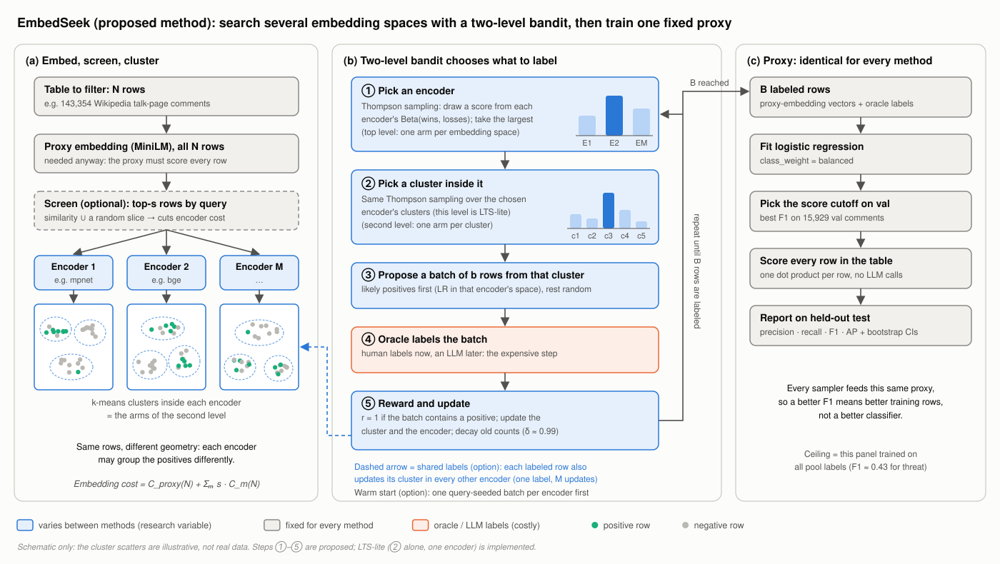

# Updated direction: hierarchical bandit + subsampled embeddings (2026-10-27)

Proposed extension of the plan in [02_step_by_step_plan.md](02_step_by_step_plan.md). Two ideas that fit together: (1) extend LTS to a **two-level bandit** (encoder → cluster), and (2) embed only a **random subsample** of rows with the extra search encoders, to control the multi-encoder cost. Status: proposal for team discussion.



*Figure: the proposed method end to end. (a) Every row gets the proxy embedding; an optional screen picks which rows the extra search encoders embed; each encoder is clustered. (b) Each round, a two-level Thompson-sampling bandit picks an encoder, then a cluster inside it, labels a batch, and updates both levels. (c) The labeled rows train the same fixed proxy used for every method. Regenerate with `scripts/make_method_figure.py`.*

## Where this sits in the proxy pipeline

```
1. Embed rows ─► 2. SAMPLE B rows ─► 3. LLM labels them ─► 4. Train LR proxy ─► 5. Run proxy over the full table
                 └── the only step we change
```

Chung et al. [1] sample uniformly at random, which fails at rare prevalence. Our samplers use embeddings to find positives. The proxy (step 4) stays fixed for every method: LR on **one reference embedding**, threshold on val, metrics on test.

## Idea 1: hierarchical bandit (encoder → cluster)

Barbosa's LTS [2] runs Thompson sampling over clusters of **one** representation. We add a layer above it:

```
Round t:
  1. Encoder level:  Thompson-sample Beta(wins_m, losses_m) per encoder m → pick encoder m*
  2. Cluster level:  Thompson-sample among k-means clusters of m* (the existing lts_lite logic) → pick cluster c*
  3. Batch:          label `batch` rows from c*: predicted positives first (LR in m*'s space), rest random
  4. Reward:         r = 1 if the batch has a positive (or positives / batch); update both c* and m*
  5. Decay:          multiply wins/losses by δ ≈ 0.99 at both levels (arms deplete over time)
```

**Why this design:**
- It's a direct, easy-to-explain extension of LTS: *the representation is also learned*.
- It reuses `lts_lite` in [src/embedseek/samplers.py](../src/embedseek/samplers.py). Only the top layer is new.
- Clusters give within-encoder diversity, which LTS-lite already suggests matters: it had the best identity_hate F1 with fewer positives (see [06_baseline_results.md](06_baseline_results.md), finding 8).

**Unique to the multi-embedding setting: share labels across encoders.** Every row has a cluster in *every* encoder. When a row is labeled, update the cluster stats it belongs to in **all** encoders, not just the one that proposed it. One label informs M clusters, which M separate copies of LTS cannot do. This should ease the sparse-feedback problem. Make it a flag (`share_labels=True/False`) so we can ablate it.

**Known risk: cold start.** LTS-lite behaves like random until it hits a cluster rich in positives. With ~3 encoders × 50 clusters = 150 arms, blind exploration is worse. Mitigations to test:
- Starting priors: give each cluster a prior from its centroid's cosine to the predicate query.
- Warm start: one query-seeded batch per encoder before Thompson sampling begins.

**Comparison table (each row isolates one question):**

| Variant | Question it answers |
|---|---|
| Random | Floor |
| LTS-lite on each encoder alone | Best fixed single encoder (the bar to beat) |
| LTS-lite on concatenated embeddings | Does simply combining encoders already work? |
| Flat: every (encoder, cluster) pair as one arm | Is the hierarchy needed, or just more arms? |
| **Hierarchical**, ± shared labels, ± warm start | Our method and its ablations |

Open choice: in step 3, the LR that ranks rows within a cluster is trained on the chosen encoder's embedding by default, so each encoder searches entirely in its own space. The alternative is the fixed proxy embedding.

## Idea 2: embed a random subsample with the search encoders

Chung et al. show the >100x savings shrink to ~2.5x when embeddings must be computed on the fly. Using M encoders multiplies that cost.

**Constraint:** the proxy must score every row, so the **proxy embedding covers the full table**. Only the *extra search encoders* are subsampled at fraction s:

```
C_embed = C_proxy(N) + Σ_m s · C_m(N)
```

**Trade-off:** samplers can only find positives inside the subsample. At s = 0.25, about 107 of the 427 pool threats are reachable, while the pseudo-example query alone found 179 at B = 1000. So s caps how many positives we can find. The deliverable is a curve of **positives found and test F1 vs embedding cost** across s. That's a direct answer to RQ4.

**Variants (after the basic sweep):**
- **Progressive embedding:** start each search encoder at a small s, and embed more rows for the encoders the bandit rewards. Embedding compute becomes part of the budget the bandit allocates.
- **Proxy-space expansion:** find positives in encoder m's subsample, then expand via their kNN in the fully embedded proxy space.

**No re-embedding needed to test this.** Embed mpnet and bge once in full (RQ1 needs that anyway), then simulate subsampling by masking each encoder to a random s-fraction of rows. Charge cost as s × measured per-row time from `meta.json`. Use a different mask per seed.

Sweep: s ∈ {1.0, 0.5, 0.25, 0.1} × B ∈ {100, 250, 500, 1000} × 10 seeds.

## Statistical reporting: bootstrap CIs

All current numbers are point estimates. Before comparing methods we add uncertainty:

- **Test-set bootstrap CI.** Resample the 63,939 test rows with replacement (e.g. 1,000 times), recompute F1/AP on each resample with the predictions held fixed, and report the 2.5th–97.5th percentiles. This captures uncertainty from having only 211 test threats. It's the *only* uncertainty estimate for deterministic samplers (query-seeded).
- **Paired bootstrap for comparisons.** To compare methods A and B, use the **same** resampled rows for both and compute F1_A − F1_B each time. If the 95% CI of the difference excludes 0, the gap is significant. Pairing cancels test-set noise shared by both methods, so it's much more sensitive than checking whether two separate CIs overlap.
- **Seed variance is separate.** Stochastic samplers (random, LTS-lite, the bandit) also vary by seed. Report the mean across 10 seeds with a CI over seeds. Keep "sampler randomness" and "test-set noise" as distinct error sources.
- **Threshold noise.** The threshold comes from 47 val threats. Resampling val too and re-picking the threshold shows how much of the variance comes from that. Average precision (threshold-free) remains the more stable headline metric.

## Revised order of work

| # | Task | Notes |
|---|---|---|
| 1 | Bootstrap CIs + paired bootstrap in [proxy.py](../src/embedseek/proxy.py) | Prerequisite for every comparison |
| 2 | Embed `all-mpnet-base-v2` and `bge-base-en-v1.5` in full; k-means (k = 50) per encoder | Add query-prefix support for bge |
| 3 | **Cheap go/no-go:** per encoder, top-5-cluster positive concentration (MiniLM: 72% threat, 68% identity_hate), and overlap of *which* positives each encoder's top clusters hold | If all encoders concentrate the same positives, the encoder layer has nothing to choose between |
| 4 | Pick the fixed proxy embedding from per-encoder ceilings | Raises the low MiniLM ceiling (F1 ≈ 0.43) |
| 5 | Implement `hierarchical_lts` (+ flat variant) with a spy-oracle test | Flags: `share_labels`, `warm_start` |
| 6 | Run the comparison table, then the subsample sweep | Simulated masks; cost from `meta.json` |

The proposal's original within-encoder strategies (query / anchor / diversity) remain as alternative ways to propose a batch within an encoder. They're a later extension, not a prerequisite.

## Open questions for the team

- Should the fixed proxy embedding also be a search arm? It may favor that arm.
- Reward: binary "found ≥ 1 positive" (LTS-like) or positives / batch? Start binary for comparability with LTS-lite, then ablate.
- Is the hierarchical bandit our *main* method, with query/anchor search as an extension, or the other way around? This doc assumes the former.
