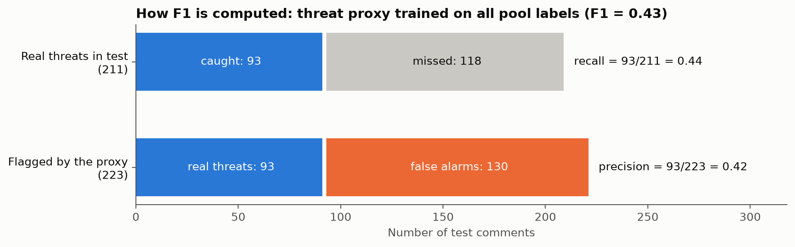
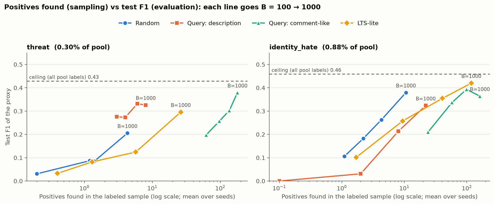
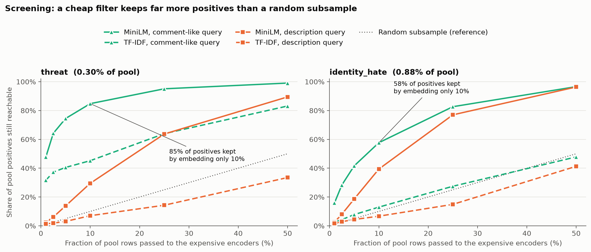

# Reference: pipeline, proxy training and every number we report

What each stage does, what data it touches, and how each metric in our tables is computed. Numbers below are from the MiniLM runs on Jigsaw (`results/*.csv`). Figures: `scripts/plot_metrics_reference.py`.

**Contents**
1. [The pipeline in one picture](#1-the-pipeline-in-one-picture)
2. [The three data splits](#2-the-three-data-splits)
3. [What "training the proxy" means](#3-what-training-the-proxy-means)
4. [Every metric at a glance](#4-every-metric-at-a-glance)
5. [How F1 is computed: worked example](#5-how-f1-is-computed-worked-example)
6. [Positives found vs F1: related, not the same](#6-positives-found-vs-f1-related-not-the-same)
7. [Screening: which rows the expensive encoders see](#7-screening-which-rows-the-expensive-encoders-see)
8. [Error bars: seeds and bootstrap CIs](#8-error-bars-seeds-and-bootstrap-cis)
9. [Glossary](#9-glossary)

---

## 1. The pipeline in one picture

```
                    POOL (143,354 comments)                         VAL (15,929)        TEST (63,939)
                           │                                              │                   │
 ┌─ SAMPLING ──────────────▼─────────────────┐                            │                   │
 │ Sampler picks B rows (B = 100…1000)       │  ◄── the only thing        │                   │
 │ Oracle labels them (human labels now,     │      that differs          │                   │
 │ an LLM later)                             │      between methods       │                   │
 │   → metric: POSITIVES FOUND               │                            │                   │
 └─────────────────────────┬─────────────────┘                            │                   │
                           │ B labeled rows                               │                   │
 ┌─ PROXY (identical for every method) ──────▼────────────────────────────▼───────────────────▼─┐
 │ 1. Fit logistic regression on the B rows' embeddings + labels                                 │
 │ 2. Pick a score cutoff that maximizes F1 on VAL                                               │
 │ 3. Score every TEST comment; above the cutoff = "predicted threat"                            │
 │ 4. Compare predictions to TEST's human labels → PRECISION, RECALL, F1, AP                     │
 └───────────────────────────────────────────────────────────────────────────────────────────────┘
```

**Key idea:** the proxy steps are the same for every sampler. If one method gets a better F1, it's because it gave the classifier **better training rows**, not a better classifier.

## 2. The three data splits

| Split | Rows | threat | identity_hate | Used for | Never used for |
|---|---|---|---|---|---|
| **Pool** | 143,354 | 427 | 1,257 | Samplers pick rows from here; the oracle reveals labels only for picked rows | Evaluation |
| **Val** | 15,929 | 47 | 140 | Choosing the proxy's score cutoff | Training, sampling, reported metrics |
| **Test** | 63,939 | 211 | 712 | **All reported F1 / precision / recall / AP** | Anything during development |

The splits are disjoint by ID and by text, and frozen (`scripts/make_splits.py`, seed 42). Test comes from Jigsaw's scored test file, so it's labeled by humans at the natural prevalence.

## 3. What "training the proxy" means

Code: `train_and_evaluate` in [src/embedseek/proxy.py](../src/embedseek/proxy.py).

**Input:** the B rows the sampler picked. For each one:
- **X**: its embedding, 384 numbers from MiniLM (precomputed and cached).
- **y**: its label from the oracle, 1 = threat, 0 = not.

**Steps:**

| Step | What happens | Data |
|---|---|---|
| 1. Fit | Logistic regression (LR) learns one weight per embedding dimension. A comment's score = weights · embedding + bias. `class_weight="balanced"` up-weights the rare positives so the model doesn't learn "always say no". | B sampled rows |
| 2. Cutoff | Score all val comments and pick the cutoff that gives the best F1 on val | Val |
| 3. Predict | Score all test comments; score ≥ cutoff → predicted positive. This is the proxy doing its real job: classifying unseen rows without the LLM, at the cost of one dot product per row. | Test (embeddings only) |
| 4. Measure | Compare predictions with test labels | Test labels |

**Why it's called a proxy:** it stands in for the LLM. In production, the LLM labels only the B sampled rows, and this cheap model answers the predicate for the remaining millions of rows.

**Edge case:** if the B rows contain **zero positives**, LR can't be fit (it needs both classes). The run is recorded as a failure: `trained = False`, F1 = 0. That happens often for random sampling of threat at small B.

**Ceiling:** the same four steps, trained on **all 143,354 pool labels**. It's the best this proxy (LR on MiniLM features) can do with perfect, unlimited labels. No sampler can beat it.

## 4. Every metric at a glance

| Metric | Stage | Computed on | Question it answers | Column in CSVs |
|---|---|---|---|---|
| **Positives found** | Sampling | The B labeled pool rows | How good is the sampler at *finding* rare positives? | `n_pos` |
| **Can train (%)** | Sampling | Share of seeds with ≥ 1 positive | How often does the method fail completely? | `trained` |
| **Precision** | Evaluation | Test | Of the comments the proxy flagged, what share are real? | `precision` |
| **Recall** | Evaluation | Test | Of the real positives, what share did the proxy catch? | `recall` |
| **F1** | Evaluation | Test | Single score balancing precision and recall | `f1` |
| **Average precision (AP)** | Evaluation | Test | How well the proxy *ranks* positives above negatives, at any cutoff | `avg_precision` |
| **Share reachable** | Screening diagnostic | Pool (true labels, after the fact) | If we embed only the top-s fraction, what share of positives can a sampler still reach? | `share_reachable` |

Sampling metrics say how good the **search** is. Evaluation metrics say how good the resulting **classifier** is. Screening is a diagnostic, not a sampler: it reads true labels, so it can only be used for analysis.

## 5. How F1 is computed: worked example

The threat proxy trained on all pool labels (the ceiling run), scored on the 211 real threats in test:



- **Recall** = caught / all real threats = 93 / 211 = **0.44**. It missed 118.
- **Precision** = real threats among those flagged / everything flagged = 93 / 223 = **0.42**. The other 130 flags are false alarms.
- **F1** = the harmonic mean of the two:

  ```
  F1 = 2 · precision · recall / (precision + recall) = 2 · 0.42 · 0.44 / (0.42 + 0.44) ≈ 0.43
  ```

F1 is high only when **both** are high. A proxy that flags everything gets recall 1.0 and precision ≈ 0.003, so F1 ≈ 0.007. A proxy that flags one obvious threat correctly gets precision 1.0 and recall 0.005, so F1 ≈ 0.01.

**Average precision (AP)** uses the proxy's raw scores instead of the cutoff. Sort test comments by score and ask how concentrated the real threats are near the top. A useless proxy scores AP ≈ prevalence (0.0033 for threat); a perfect one scores 1.0. AP doesn't depend on the val-chosen cutoff (only 47 val threats, so that cutoff is noisy), which makes it the more stable comparison.

## 6. Positives found vs F1: related, not the same

Each line is one sampler as the budget grows from B = 100 to 1000 (mean over seeds where the sampler is random). The x-axis is the sampling metric; the y-axis is the evaluation metric.



How to read it:
- **More positives generally helps, but not proportionally.** The comment-like query (green) finds 62 → 179 threats while F1 rises only 0.20 → 0.38.
- **Few positives can still do well.** The description query (orange, threat) finds only 3–8 threats yet beats random, probably because its *negatives* are hard (toxic but not threatening) and teach the boundary.
- **Which positives matter, not just how many.** For identity_hate at B = 1000, LTS-lite (yellow) finds fewer positives than the comment-like query (118 vs 162) but gets higher F1 (0.42 vs 0.36). It draws from several clusters, so its positives are more varied.
- **Everything sits under the ceiling** (dashed). The gap between the methods and the ceiling is the room samplers have to improve.

This is why we always report **both** numbers.

## 7. Screening: which rows the expensive encoders see

**Context.** Using several encoders multiplies embedding cost. The proxy must embed **every** row (it has to score the whole table), so that embedding is already paid for. The idea: use it as a cheap **screen**, and give the extra, expensive encoders only the top-s fraction of rows most similar to the predicate.

**What we measured** (`scripts/filter_recall.py`): rank all pool rows by a cheap score, then count what share of the true positives land in the top s. A random subsample keeps exactly s of them (the dotted diagonal).



| Screen (comment-like query) | share of positives kept at s = 10% | at s = 25% |
|---|---|---|
| Random subsample | 10% | 25% |
| TF-IDF (word overlap) | threat 45%, identity_hate 13% | 64%, 27% |
| **MiniLM** (the proxy embedding) | **threat 85%, identity_hate 58%** | **95%, 83%** |

**Takeaways:**
- A good screen keeps most positives while embedding a small fraction of rows. A random subsample can't.
- The proxy embedding is a much better screen than word overlap (TF-IDF), and it costs nothing extra.
- Query wording matters: description queries are weaker screens, and TF-IDF with a description is *worse* than random.

**The catch, in plain terms.** The screen is one encoder's opinion, and it decides what the other encoders get to look at. The positives it drops are exactly the ones it ranks low: the ones another encoder might have found. That's the whole reason to use several encoders. If the screen is too strict, a "no gain from multiple encoders" result could be caused by the screen hiding what they're good at, rather than by the encoders themselves. Mitigations:
- Always include a **random slice** (a few %) alongside the screened rows.
- Screen with **several queries** and take the union.
- **Expand progressively:** when an expensive encoder finds a positive, embed more rows around it.
- **Report share reachable** with every screened result, so readers see how much the screen limited the search.

Caveat: these numbers show which positives are *reachable*. They're not what the bandit finds or the final F1.

## 8. Error bars: seeds and bootstrap CIs

Two separate sources of uncertainty, both reported:

| Source | Applies to | How we measure it |
|---|---|---|
| **Sampler randomness** | Random, LTS-lite, the bandit | Run 10 seeds; report mean and spread |
| **Test-set noise** (only 211 test threats) | Every method, including deterministic ones like query-seeded | Bootstrap CI |

**Bootstrap confidence interval (CI)**
1. Train the proxy once and keep its fixed predictions on the 63,939 test rows.
2. Draw 63,939 rows *with replacement* from the test set (some repeat, some drop out) and compute F1 on that draw.
3. Repeat ~1,000 times.
4. The 2.5th–97.5th percentiles are the 95% CI, e.g. "F1 0.38 [0.33, 0.43]".

Nothing is retrained; only step 4 of the proxy is repeated, so it's cheap.

**Paired bootstrap (comparing methods A and B).** Use the **same** resampled rows for both and record F1_A − F1_B each time. If the 95% interval of the difference excludes 0, the gap is real. Pairing cancels noise both methods share, so it detects smaller real differences than checking whether two separate CIs overlap.

**Threshold noise.** The cutoff comes from only 47 val threats. Resampling val too and re-picking the cutoff shows how much of the variance comes from that. This is another reason to put AP next to F1.

## 9. Glossary

| Term | Meaning |
|---|---|
| **Predicate** | The yes/no question the semantic filter asks, e.g. "is this comment a threat?" |
| **Prevalence** | Share of rows where the predicate is true (threat: 0.30%) |
| **Budget B** | Number of rows we pay the oracle/LLM to label |
| **Oracle** | Whatever supplies labels for picked rows. Simulated with human labels now, an LLM later. Samplers can only see labels by asking it. |
| **Sampler** | Strategy for picking the B rows: random, query-seeded, LTS-lite, bandit… |
| **Proxy** | The cheap classifier (LR on embeddings) trained on the B labels and run on everything else |
| **Proxy embedding** | The one embedding the proxy uses, computed for every row. Fixed across methods. |
| **Search encoder** | An embedding a sampler searches in. These can vary, and can be subsampled or screened. |
| **Ceiling** | Proxy trained on all pool labels: the upper bound for this proxy |
| **Seed** | Random-number setting for one run. 10 seeds = 10 independent repeats. |
| **Screen / share reachable** | Cheap pre-filter choosing which rows the expensive encoders embed / share of true positives that survive it |
